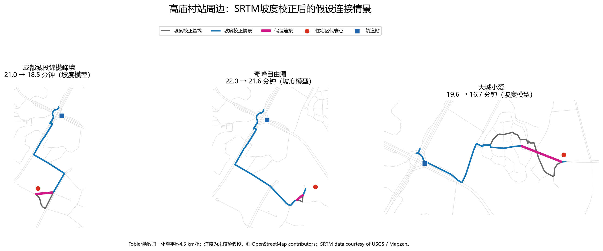
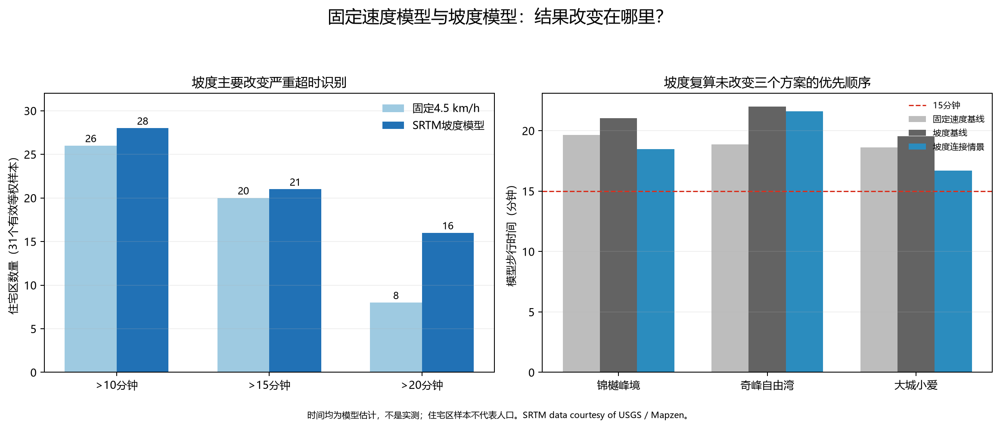
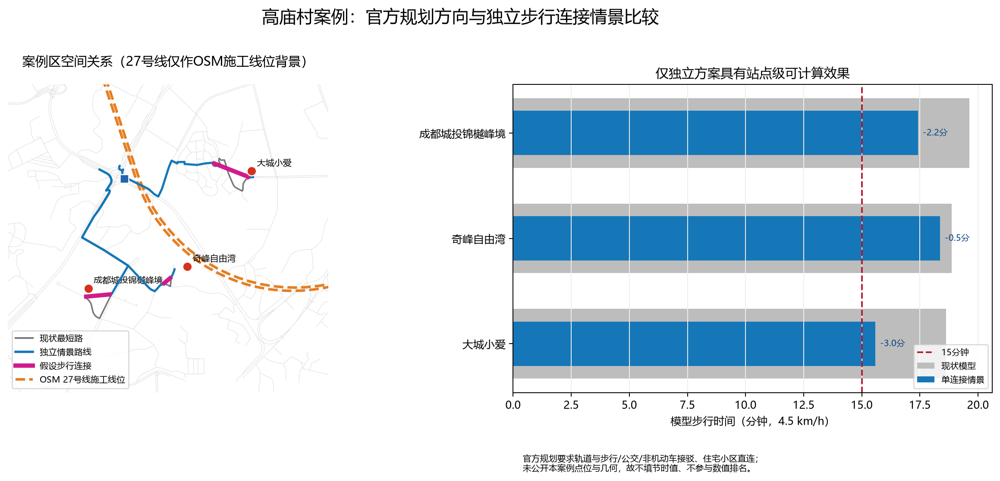

# 重庆轨道交通步行可达性与服务差异研究

一个以公开数据、可复现 Python 工作流和审慎证据边界为核心的城市交通研究项目。

**English overview:** A reproducible, open-data study of walking accessibility around Chongqing Rail Transit stations. The current MVP models four operational stations in the Shapingba–Gaomiaocun corridor using an OpenStreetMap walking network. It does not claim population coverage or citywide conclusions.

## 项目研究目标

重庆具有山地、河谷、桥隧和立体街道等复杂空间特征。以车站为中心画直线缓冲区，容易把无法直接穿越的坡地、封闭地块或立体道路误判为可达。本项目希望逐步建立基于真实道路网络的轨道站点步行可达性模型，并在数据充分后研究人口覆盖、服务差异和官方规划情景。

项目作为数据分析作品集，同时保留研究过程、数据来源、计算代码、失败修复和证据限制。最终目标不是堆积报告，而是用可复现数据分析识别重庆轨道交通的具体问题，提出可检验的改善假设，并与政府公开规划进行审慎比较。

## 已经回答的实际交通问题

本阶段回答了：**沙坪坝—高庙村走廊中，哪些具名住宅区到轨道站步行不便；单一短步行连接能改善多少；这些独立方案与重庆官方规划是什么关系。**

- 33个OSM具名住宅区中，31个通过道路吸附质量门槛；按4.5 km/h，20个模型路线超过15分钟、8个超过20分钟。样本等权，**不是人口比例**。
- 3个高庙村站周边候选住宅区完成了显式网络改造情景；每处只增加一条20—250米的假设连接。
- 加入SRTM高程和方向性坡度时间后，超过15分钟和20分钟的住宅区分别变为21个和16个；20条最短时间路线改变，但最近模型车站分配未改变。
- 官方“十五五”规划支持轨道站与步行、公交、非机动车及住宅小区直连，但没有公布这3个案例的项目几何，不能填写官方方案的本地节时或成本。

### 三个住宅区改善前后比较

基准步速为4.5 km/h。下表全部是道路网络模型估计，不是实测时间；“模拟后”不表示设施已经存在或已经建成。

| 住宅区 | 最近模型站 | 改善前距离 | 模拟后距离 | 改善前时间 | 模拟后时间 | 节省时间 | 降幅 |
| --- | --- | ---: | ---: | ---: | ---: | ---: | ---: |
| 成都城投锦樾峰境 | 高庙村 | 1,473米 | 1,307米 | 19.6分钟 | 17.4分钟 | 2.2分钟 | 11.3% |
| 奇峰自由湾 | 高庙村 | 1,415米 | 1,377米 | 18.9分钟 | 18.4分钟 | 0.5分钟 | 2.6% |
| 大城小爱 | 高庙村 | 1,397米 | 1,169米 | 18.6分钟 | 15.6分钟 | 3.0分钟 | 16.3% |


连接线仅为网络筛查情景，尚未核验建筑、挡墙、坡度、铁路、土地权属、全天通行和施工条件。

### 坡度校正后的三个案例

Tobler函数已归一化至平地4.5 km/h。坡度时间仍是模型预测，不是实测。

| 住宅区 | 坡度基线 | 坡度连接情景 | 节省 | 情景后≤15分钟 |
| --- | ---: | ---: | ---: | --- |
| 成都城投锦樾峰境 | 21.0分钟 | 18.5分钟 | 2.6分钟（12.2%） | 否 |
| 奇峰自由湾 | 22.0分钟 | 21.6分钟 | 0.4分钟（1.8%） | 否 |
| 大城小爱 | 19.6分钟 | 16.7分钟 | 2.9分钟（14.6%） | 否 |





代码与逻辑审查有条件通过：实现正确区分住宅区到车站方向，35%坡度截断不改变总体阈值结论，但当前没有现场实测时间，**不能据此断言坡度模型已经比固定速度模型更准确**。

## 最重要的研究结论

1. 坡度校正使超过20分钟的住宅区由8个增至16个；这说明地形假设会显著改变严重超时识别，但哪种模型更接近现实仍需现场时间验证。
2. 大城小爱和成都城投锦樾峰境在平地与坡度模型中均保持较高连接收益，适合优先现场核验。
3. 奇峰自由湾的坡度情景仅节省0.4分钟；除非现场发现OSM漏路或真实大门不同，单一连接不应列为优先方案。
4. 三处在坡度基准情景下仍超过15分钟。模型支持“优先实地核验”，不支持直接推荐施工、声称人口收益或经济回报。
5. 坡度强度敏感性没有改变三个方案的总体排序，但绝对时间变化明显；高程模型不能替代工程测量。

## 与官方规划的比较

重庆市政府2026年7月29日印发的“十五五”综合交通规划明确要求加强轨道与公交、非机动车、步行接驳，推动未开通出入口应开尽开，并加强车站与市政道路、住宅小区、商业楼宇直连直通。政策方向与本项目识别的住宅区局部绕行问题一致，且提出公交轨道50米接驳率由84%提升至87%的全市目标。

独立方案的新增价值是把政策方向落到3个可复现点位：按4.5 km/h，大城小爱、成都城投锦樾峰境、奇峰自由湾分别节省3.0、2.2、0.5分钟。公开规划没有点名这3处，也没有案例级线位、成本或人口，因此官方方案不填本地节时值、不参与数值排名。27号线属于区域快线层级，截至2026-08-18仍为在建/系统调试状态，也不能替代第一/最后一公里评价。



完整结论、证据边界和可反驳验证方法见 [`reports/official_plan_comparison_case_study.md`](reports/official_plan_comparison_case_study.md)。

## 住宅区问题筛查

在33个OSM具名住宅区中，31个通过道路吸附质量门槛。按4.5 km/h固定步速，超过10、15、20分钟的模型路线分别为26、20、8个（占等权住宅区样本83.9%、64.5%、25.8%，**不是人口比例**）。其中6个在“路线长度可缩短到直线距离1.25倍”的筛查情景下可能进入15分钟，集中在高庙村站周边；另14个在该情景下仍超时，更适合优先核验公交接驳或更大范围交通改善。

道路图共有13个连通分量，最大分量包含94.1%的节点；12个车站出入口全部落在同一分量。31个有效住宅起点均可连接到车站分量，另2个住宅起点因距已映射道路超过150米被排除，而不是被判定为真实不可达。

完整方法、名单和敏感性见 [`reports/residential_accessibility_report.md`](reports/residential_accessibility_report.md)。

## 走廊步行可达性地图


地图使用4.5 km/h固定步速：10分钟为750米，15分钟为1,125米。蓝色色带是可达道路的25米制图缓冲，不是人口覆盖范围。

| 站点 | OSM出入口 | 10分钟可达道路 | 15分钟可达道路 |
| --- | ---: | ---: | ---: |
| 沙坪坝 | 5 | 24.30 km | 46.24 km |
| 小龙坎 | 3 | 13.40 km | 32.08 km |
| 马家岩 | 2 | 5.45 km | 11.54 km |
| 高庙村 | 2 | 17.58 km | 31.29 km |

道路长度差异也受道路密度、出入口数量和 OSM 完整性影响，不能直接解释为站点服务水平排名。

## 完整研究报告

- [`reports/official_plan_comparison_case_study.md`](reports/official_plan_comparison_case_study.md)：官方规划与独立方案正式比较案例；
- [`reports/slope_accessibility_report.md`](reports/slope_accessibility_report.md)：SRTM高程、方向性坡度时间和三个案例复算；
- [`reports/field_validation_plan.md`](reports/field_validation_plan.md)：下一阶段8条路线的低成本现场验证方案；
- [`reports/improvement_case_study.md`](reports/improvement_case_study.md)：3个假设步行连接的前后效果与敏感性；
- [`reports/residential_accessibility_report.md`](reports/residential_accessibility_report.md)：33个具名住宅区的筛查、差区域和质量检查；
- [`validation_report.md`](validation_report.md)：自动化测试和真实数据集成验证。

## 研究范围与完成状态

已完成4个已运营站、12个OSM出入口、7,456条道路图边、33个具名住宅区、3个改善情景、SRTM方向性坡度时间以及官方规划分层比较。尚未完成全重庆分析、人口/岗位/客流覆盖、本地步行时间校准、工程级设计和有真实班次数据的公交接驳情景。

## 数据来源

| 数据 | 本项目用途 | 时间 | 公开方式 |
| --- | --- | --- | --- |
| 重庆市交通运输委员会运营线网图 | 核验4个测试站已运营 | 图面2024-12 | 官方网页/PDF；仓库不镜像原件 |
| OpenStreetMap / Geofabrik 重庆提取 | 站点坐标、出入口、步行道路 | 快照2026-10-09 | ODbL；原PBF不提交 |
| 《重庆统计年鉴 2025》 | 已核验人口和交通表入口，尚未用于MVP | 主要为2024统计 | 官方PDF；不提交原件 |
| 重庆市国土空间总体规划公开版 | 规划证据准备 | 2021—2035 | 官方PDF；不提交原件 |
| 《重庆市“十五五”综合交通运输发展规划》 | 官方接驳目标、政策方向与案例对照 | 2026—2030 | 市政府正式文件；仓库记录URL、日期和校验值，不镜像原件 |
| Mapzen Terrain Tiles / SRTM | 道路节点高程与方向性坡度时间 | SRTM约2000年获取 | 公共领域；保留USGS与Mapzen来源说明，原HGT不提交 |

完整来源、URL、许可、下载日期和 SHA-256 见 [`data_sources.md`](data_sources.md)。原始文件下载脚本为 [`scripts/download_source_data.py`](scripts/download_source_data.py)，OSM 署名与 ODbL 说明见 [`NOTICE.md`](NOTICE.md)。

## 方法概览

1. 从本地 OSM PBF 的指定小范围提取可步行道路；
2. 过滤禁止步行、私人通行和不适合步行的道路类型；
3. 投影到 EPSG:32648，以米构建 NetworkX 无向加权图；
4. 将每站300米内的已映射地铁出入口分配给最近站点；
5. 以每站全部出入口为源点执行多源 Dijkstra；
6. 计算750米和1,125米阈值内的可达道路；
7. 输出站点、出入口、道路、服务区、统计表和地图。

完整定义、公式和字段说明见 [`methodology.md`](methodology.md)。

## 技术栈

Python 3.13、Pandas、GeoPandas、Pyogrio、Shapely、PyProj、NetworkX、Matplotlib 和 Pytest。当前验证过的精确版本记录在 [`requirements.txt`](requirements.txt)。

## 本地复现

### 1. 创建环境

```powershell
python -m venv .venv
.venv\Scripts\Activate.ps1
python -m pip install --upgrade pip
python -m pip install -r requirements.txt
```

### 2. 下载原始数据

复现当前步行与坡度分析需下载固定的OSM快照和SRTM瓦片：

```powershell
python scripts/download_source_data.py osm srtm_n29e106
```

下载全部已调查原件可运行 `python scripts/download_source_data.py`。原始文件写入被 Git 忽略的 `work/data_source_survey/`，下载后自动校验 SHA-256。

### 3. 运行分析

```powershell
$env:PYTHONPATH = "src"
python -m chongqing_rail_transit.walk_accessibility_mvp `
  --pbf work/data_source_survey/chongqing_osm_2026-10-10.osm.pbf
python -m chongqing_rail_transit.residential_accessibility `
  --pbf work/data_source_survey/chongqing_osm_2026-10-10.osm.pbf
python -m chongqing_rail_transit.improvement_simulation `
  --pbf work/data_source_survey/chongqing_osm_2026-10-10.osm.pbf
python -m chongqing_rail_transit.official_plan_comparison `
  --pbf work/data_source_survey/chongqing_osm_2026-10-10.osm.pbf
python -m chongqing_rail_transit.slope_accessibility `
  --pbf work/data_source_survey/chongqing_osm_2026-10-10.osm.pbf `
  --hgt work/data_source_survey/N29E106.hgt.gz
```

### 4. 运行测试

```powershell
python -m pytest -q
```

预期结果为 `12 passed`。完整验证记录见 [`validation_report.md`](validation_report.md)。

## 主要输出

- [`data/processed/shapingba_accessibility_summary.csv`](data/processed/shapingba_accessibility_summary.csv)：逐站、逐阈值统计；
- [`data/processed/shapingba_walk_accessibility_metadata.json`](data/processed/shapingba_walk_accessibility_metadata.json)：模型参数和限制；
- [`data/processed/shapingba_residential_accessibility.csv`](data/processed/shapingba_residential_accessibility.csv)：具名住宅区逐点路线、绕行与质量字段；
- [`data/processed/shapingba_residential_accessibility_sensitivity.csv`](data/processed/shapingba_residential_accessibility_sensitivity.csv)：步速和直接性情景；
- [`data/processed/shapingba_poor_accessibility_areas.csv`](data/processed/shapingba_poor_accessibility_areas.csv)：超过15分钟的20个住宅区结果表；
- [`data/processed/shapingba_improvement_candidates.csv`](data/processed/shapingba_improvement_candidates.csv)：下一轮步行连接与接驳模拟候选；
- [`data/processed/shapingba_walk_network_connectivity.csv`](data/processed/shapingba_walk_network_connectivity.csv)：道路图连通性质量检查；
- [`data/processed/shapingba_improvement_simulation.csv`](data/processed/shapingba_improvement_simulation.csv)：3个案例改善前后对比；
- [`data/processed/shapingba_improvement_simulation_sensitivity.csv`](data/processed/shapingba_improvement_simulation_sensitivity.csv)：步速与连接阻抗敏感性；
- [`data/processed/shapingba_official_independent_comparison.csv`](data/processed/shapingba_official_independent_comparison.csv)：官方政策、27号线与3个独立情景的无评分对比表；
- [`data/processed/shapingba_official_plan_evidence.csv`](data/processed/shapingba_official_plan_evidence.csv)：官方规划和项目状态证据；
- [`data/processed/shapingba_slope_adjusted_residential.csv`](data/processed/shapingba_slope_adjusted_residential.csv)：31个有效住宅区的4档坡度强度结果；
- [`data/processed/shapingba_slope_adjusted_improvement.csv`](data/processed/shapingba_slope_adjusted_improvement.csv)：三个连接案例的坡度敏感性；
- `data/processed/shapingba_slope_adjusted_improvement.gpkg`：坡度基准路线、情景路线、代表点和连接；
- [`data/processed/shapingba_slope_edge_quality.csv`](data/processed/shapingba_slope_edge_quality.csv)：7,456条边的高程、坡度、截断及桥隧楼梯审计字段；
- [`data/processed/shapingba_slope_cap_sensitivity_summary.csv`](data/processed/shapingba_slope_cap_sensitivity_summary.csv)：20%—100%坡度截断上限对总体结果的影响；
- [`data/processed/shapingba_slope_cap_sensitivity_cases.csv`](data/processed/shapingba_slope_cap_sensitivity_cases.csv)：截断上限对三个案例的影响；
- `data/processed/shapingba_official_independent_comparison.gpkg`：案例点、假设连接和OSM 27号线施工背景几何；
- `data/processed/shapingba_improvement_simulation.gpkg`：改善前路线、模拟路线、连接和住宅点；
- `data/processed/shapingba_residential_accessibility.gpkg`：住宅区原点和模型路线空间数据；
- `data/processed/shapingba_walk_accessibility_mvp.gpkg`：站点、出入口、道路和服务区空间数据；
- [`reports/figures/shapingba_residential_accessibility.png`](reports/figures/shapingba_residential_accessibility.png)：住宅区筛查地图；
- [`reports/figures/shapingba_slope_adjusted_improvement.png`](reports/figures/shapingba_slope_adjusted_improvement.png)：三个案例的坡度基线路线与连接情景地图；
- [`reports/figures/shapingba_slope_model_comparison.png`](reports/figures/shapingba_slope_model_comparison.png)：固定速度与坡度模型的结果对比图；
- [`reports/figures/shapingba_walk_accessibility_mvp.png`](reports/figures/shapingba_walk_accessibility_mvp.png)：主要地图；
- [`data/processed/official_project_status_evidence.csv`](data/processed/official_project_status_evidence.csv)：官方项目状态证据。

## 研究过程导航

- [`research_plan.md`](research_plan.md)：目标、研究问题和阶段计划；
- [`research_log.md`](research_log.md)：实际进展、决策、问题和修复；
- [`data_sources.md`](data_sources.md)：数据来源、快照、许可和校验值；
- [`methodology.md`](methodology.md)：模型、算法和假设；
- [`limitations.md`](limitations.md)：局限、数据缺失和待办；
- [`validation_report.md`](validation_report.md)：测试与验证结果；
- [`reports/data_source_investigation_report.md`](reports/data_source_investigation_report.md)：数据资源调查报告；
- [`reports/residential_accessibility_report.md`](reports/residential_accessibility_report.md)：具名住宅区到站分析；
- [`reports/improvement_case_study.md`](reports/improvement_case_study.md)：假设步行连接案例研究；
- [`reports/official_plan_comparison_case_study.md`](reports/official_plan_comparison_case_study.md)：官方规划与独立方案正式比较案例；
- [`reports/slope_accessibility_report.md`](reports/slope_accessibility_report.md)：方向性坡度模型与结果；
- [`reports/field_validation_plan.md`](reports/field_validation_plan.md)：现场路线、采集字段和MAE评价方案；
- [`policy_comparison.md`](policy_comparison.md)：官方规划证据、项目状态与独立方案比较边界；
- [`delivery_check_report.md`](delivery_check_report.md)：公开发布前检查报告。

## 已知局限

当前坡度模型使用约30米SRTM和未经重庆本地校准的Tobler函数，不能识别楼梯、挡墙、室内高差和垂直交通。模型仍没有站内时间、候车时间、人口、岗位和客流，OSM出入口及小路也可能缺失。因此结果只能表述为指定假设下的网络估计，不能表述为人口覆盖、实测时间或投资优先级。

详见 [`limitations.md`](limitations.md)。

## 下一阶段

1. 人工核验测试区出入口和关键道路连接；
2. 实测重点路线时间、高程、楼梯和真实大门位置，校准坡度函数；
3. 寻找许可清晰、年份匹配的人口栅格或更细官方人口数据；
4. 在小区域验证稳定后再扩展到重庆中心城区；
5. 使用相同指标分别构建当前运营、官方在建、官方规划和独立建议情景。

## 许可状态

OSM 派生数据库和地图遵守 ODbL 相关要求，详见 [`NOTICE.md`](NOTICE.md)。项目代码和原创文档的开源许可证尚待项目负责人确认，当前不要推定为 MIT、Apache 等许可证。
