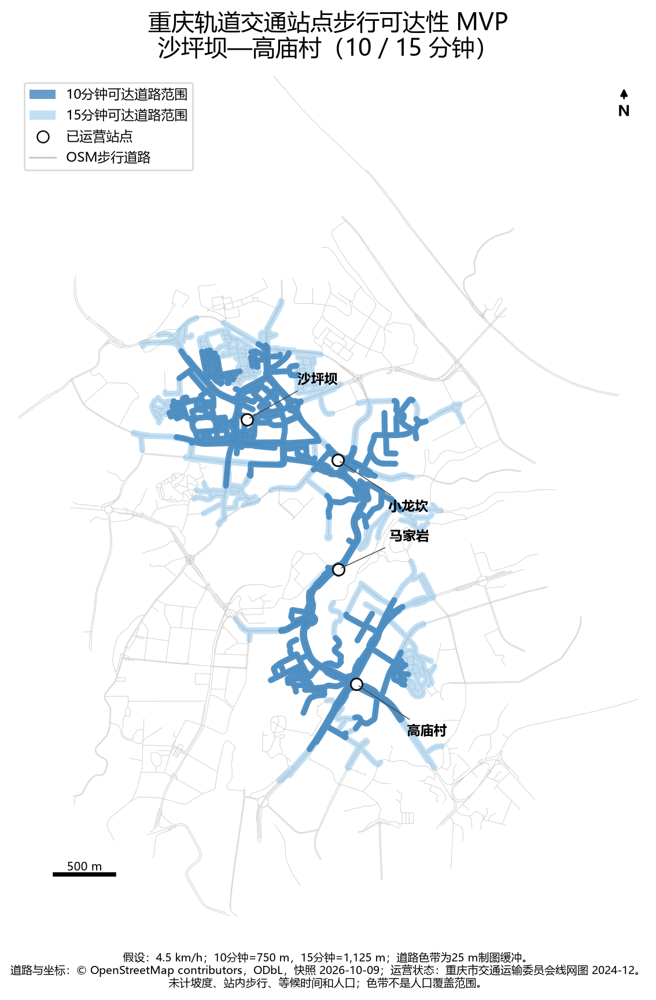

# 重庆轨道交通步行可达性与服务差异研究

一个以公开数据、可复现 Python 工作流和审慎证据边界为核心的城市交通研究项目。

**English overview:** A reproducible, open-data study of walking accessibility around Chongqing Rail Transit stations. The current MVP models four operational stations in the Shapingba–Gaomiaocun corridor using an OpenStreetMap walking network. It does not claim population coverage or citywide conclusions.

## 项目背景

重庆具有山地、河谷、桥隧和立体街道等复杂空间特征。以车站为中心画直线缓冲区，容易把无法直接穿越的坡地、封闭地块或立体道路误判为可达。本项目希望逐步建立基于真实道路网络的轨道站点步行可达性模型，并在数据充分后研究人口覆盖、服务差异和官方规划情景。

项目作为数据分析作品集，同时保留研究过程、数据来源、方法选择、失败修复和限制，而不只展示最终图片。

## 核心问题

1. 乘客从真实地铁出入口出发，10分钟和15分钟可以沿道路走到哪些位置？
2. 山地地形、道路连通和出入口完整性会如何影响可达范围？
3. 在取得可靠人口数据后，不同站点和区域的人口服务覆盖是否存在差异？
4. 独立识别的稳定服务缺口与官方规划、获批和在建项目有哪些一致和差异？

## 当前完成状态

已完成：

- 项目结构、研究计划、研究日志、来源登记、方法和限制文档；
- 官方线网图、统计年鉴、国土空间规划和 OSM 重庆数据的来源调查；
- 官方项目“规划—获批—在建—已运营”证据分类和结构化状态表；
- 沙坪坝—高庙村走廊4个已运营站点的步行可达性 MVP；
- 10/15分钟道路网络计算、GeoPackage、CSV、JSON和静态地图；
- 自动化测试和真实数据完整性检查。

尚未完成：全重庆分析、人口/岗位/客流覆盖、坡度惩罚、独立线路改善方案及与官方规划的定量效果比较。

## 代表性成果



地图使用4.5 km/h固定步速：10分钟为750米，15分钟为1,125米。蓝色色带是可达道路的25米制图缓冲，不是人口覆盖范围。

| 站点 | OSM出入口 | 10分钟可达道路 | 15分钟可达道路 |
| --- | ---: | ---: | ---: |
| 沙坪坝 | 5 | 22.75 km | 43.88 km |
| 小龙坎 | 3 | 12.16 km | 29.88 km |
| 马家岩 | 2 | 5.30 km | 10.94 km |
| 高庙村 | 2 | 16.11 km | 29.64 km |

道路长度差异也受道路密度、出入口数量和 OSM 完整性影响，不能直接解释为站点服务水平排名。

## 数据来源

| 数据 | 本项目用途 | 时间 | 公开方式 |
| --- | --- | --- | --- |
| 重庆市交通运输委员会运营线网图 | 核验4个测试站已运营 | 图面2024-12 | 官方网页/PDF；仓库不镜像原件 |
| OpenStreetMap / Geofabrik 重庆提取 | 站点坐标、出入口、步行道路 | 快照2026-10-09 | ODbL；原PBF不提交 |
| 《重庆统计年鉴 2025》 | 已核验人口和交通表入口，尚未用于MVP | 主要为2024统计 | 官方PDF；不提交原件 |
| 重庆市国土空间总体规划公开版 | 规划证据准备 | 2021—2035 | 官方PDF；不提交原件 |

完整来源、URL、许可、下载日期和 SHA-256 见 [`data_sources.md`](data_sources.md)。原始文件下载脚本为 [`scripts/download_source_data.py`](scripts/download_source_data.py)，OSM 署名与 ODbL 说明见 [`NOTICE.md`](NOTICE.md)。

## 方法概览

1. 从本地 OSM PBF 的指定小范围提取可步行道路；
2. 过滤禁止步行、私人通行和不适合步行的道路类型；
3. 投影到 EPSG:32648，以米构建 NetworkX 无向加权图；
4. 将每站300米内的已映射地铁出入口分配给最近站点；
5. 以每站全部出入口为源点执行多源 Dijkstra；
6. 计算750米和1,125米阈值内的可达道路；
7. 输出站点、出入口、道路、服务区、统计表和地图。

完整定义、公式和字段说明见 [`methodology.md`](methodology.md)。

## 技术栈

Python 3.13、Pandas、GeoPandas、Pyogrio、Shapely、PyProj、NetworkX、Matplotlib 和 Pytest。当前验证过的精确版本记录在 [`requirements.txt`](requirements.txt)。

## 本地复现

### 1. 创建环境

```powershell
python -m venv .venv
.venv\Scripts\Activate.ps1
python -m pip install --upgrade pip
python -m pip install -r requirements.txt
```

### 2. 下载原始数据

复现当前 MVP 只需下载固定的 OSM 快照：

```powershell
python scripts/download_source_data.py osm
```

下载全部已调查原件可运行 `python scripts/download_source_data.py`。原始文件写入被 Git 忽略的 `work/data_source_survey/`，下载后自动校验 SHA-256。

### 3. 运行分析

```powershell
$env:PYTHONPATH = "src"
python -m chongqing_rail_transit.walk_accessibility_mvp `
  --pbf work/data_source_survey/chongqing_osm_2026-10-10.osm.pbf
```

### 4. 运行测试

```powershell
python -m pytest -q
```

预期结果为 `3 passed`。完整验证记录见 [`validation_report.md`](validation_report.md)。

## 主要输出

- [`data/processed/shapingba_accessibility_summary.csv`](data/processed/shapingba_accessibility_summary.csv)：逐站、逐阈值统计；
- [`data/processed/shapingba_walk_accessibility_metadata.json`](data/processed/shapingba_walk_accessibility_metadata.json)：模型参数和限制；
- `data/processed/shapingba_walk_accessibility_mvp.gpkg`：站点、出入口、道路和服务区空间数据；
- [`reports/figures/shapingba_walk_accessibility_mvp.png`](reports/figures/shapingba_walk_accessibility_mvp.png)：主要地图；
- [`data/processed/official_project_status_evidence.csv`](data/processed/official_project_status_evidence.csv)：官方项目状态证据。

## 研究过程导航

- [`research_plan.md`](research_plan.md)：目标、研究问题和阶段计划；
- [`research_log.md`](research_log.md)：实际进展、决策、问题和修复；
- [`data_sources.md`](data_sources.md)：数据来源、快照、许可和校验值；
- [`methodology.md`](methodology.md)：模型、算法和假设；
- [`limitations.md`](limitations.md)：局限、数据缺失和待办；
- [`validation_report.md`](validation_report.md)：测试与验证结果；
- [`reports/data_source_investigation_report.md`](reports/data_source_investigation_report.md)：数据资源调查报告；
- [`policy_comparison.md`](policy_comparison.md)：官方规划对比的证据准备工作；
- [`delivery_check_report.md`](delivery_check_report.md)：公开发布前检查报告。

## 已知局限

当前模型没有坡度、高程、站内时间、候车时间、人口、岗位和客流。OSM 出入口及小路也可能缺失。运营状态与道路快照存在时间差。因此当前结果只表示指定假设下的道路网络可达范围，不能表述为人口覆盖、实际客流或投资优先级。

详见 [`limitations.md`](limitations.md)。

## 下一阶段

1. 人工核验测试区出入口和关键道路连接；
2. 引入高程与坡度惩罚并进行敏感性分析；
3. 寻找许可清晰、年份匹配的人口栅格或更细官方人口数据；
4. 在小区域验证稳定后再扩展到重庆中心城区；
5. 使用相同指标分别构建当前运营、官方在建、官方规划和独立建议情景。

## 许可状态

OSM 派生数据库和地图遵守 ODbL 相关要求，详见 [`NOTICE.md`](NOTICE.md)。项目代码和原创文档的开源许可证尚待项目负责人确认，当前不要推定为 MIT、Apache 等许可证。
