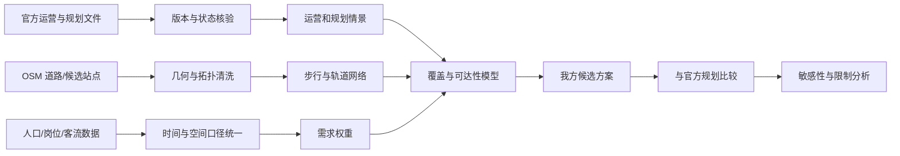

# 重庆轨道交通官方规划对比：证据审计与研究准备度报告

**版本日期：** 2026-10-10（Asia/Shanghai）

**研究状态：** 规划对比证据准备阶段；步行可达性 MVP 已完成，但尚无人口覆盖模型或独立线路方案，因此不构成规划方案优劣结论

**空间范围：** 重庆市，重点关注中心城区；市域（郊）铁路是否纳入最终模型尚待确定

**时间口径：** 运营基线暂以已取得的 2024 年 12 月官方线网图为准；项目建设状态采用截至本报告日期前能够核验的最新官方材料，并逐条标注证据日期

## 摘要

本轮审计发现，仓库中**尚不存在已经完成并验证的轨道覆盖率、步行可达性、网络中心性、人口服务率、改善方案或敏感性分析结果**。现有成果仅包括项目框架、数据来源调查，以及四份尚未进入清洗和模型验证阶段的原始资料。因此，目前不能诚实地识别“服务覆盖不足区域”，也不能比较“我们的改善建议”与官方规划的优劣。

本报告完成了三项可支持后续研究的工作：

1. 建立“规划—获批—在建—已运营”的状态定义和证据规则；
2. 用官方材料整理一份非穷尽的项目状态证据表；
3. 给出覆盖分析、规划对比和敏感性分析的可执行方案，并列明工程、财政、地形和未公开数据造成的限制。

**当前可成立的结论只有证据准备度结论，而不是交通服务结论。** 若现在输出“覆盖不足地图”或对某条规划线路作效果排名，将产生虚假精确性。

## 1. 事实、模型估计与判断的标记规则

| 标签 | 含义 | 本报告中的使用方式 |
| --- | --- | --- |
| **[事实]** | 可由已核验的政府原文、官方统计或带明确许可的原始数据直接支持 | 必须附来源、发布日期或状态日期；不把新闻目标写成已实现结果 |
| **[模型估计]** | 由清洗后的空间数据、参数和算法计算得出 | 必须保存代码、输入版本、参数、误差和复现步骤；本报告尚无此类结果 |
| **[假设]** | 为建模而选取、但未被官方数据直接证明的参数或边界 | 例如步行速度、站点吸引半径；必须进入敏感性分析 |
| **[研究判断]** | 在事实与模型结果基础上的解释、权衡或建议 | 必须同时列出支持证据、反对证据和不确定性 |

## 2. 当前证据准备度

| 研究组件 | 当前状态 | 已有证据 | 尚缺内容 | 能否支持结论 |
| --- | --- | --- | --- | --- |
| 运营线网结构 | 部分具备 | 2024-12 官方示意线网图；2026-02 官方线网图页面入口 | 经官方核验的机器可读站点坐标、线路几何、开通日期表 | 只能核验站名和换乘关系，不能测量覆盖 |
| 道路与步行网络 | 原始数据已取得 | 2026-10-09 OSM 重庆 PBF | 拓扑清洗、步行限制核验、坡度与过江通道处理、质量抽查 | 不能直接支持可达性结论 |
| 人口空间分布 | 区县总量部分具备 | 《重庆统计年鉴 2025》的 2024 年区县常住人口 | 与同年份区划一致的边界/面积、街道或栅格人口、岗位分布 | 不能识别站点尺度不足区域 |
| 客流与需求 | 严重不足 | 年鉴系统总量、少量新闻和公示快照 | 连续站点客流、OD、时段分布、公交接驳、岗位与出行目的 | 不能验证需求或拥挤改善效果 |
| 官方规划 | 部分具备 | 国土空间总体规划、第四期相关官方材料、项目批复和施工进度 | 第四期及调整的稳定完整批复版本链、第五期最终批复 | 可做状态审计，不能做完整空间叠加 |
| 我方改善方案 | 不存在 | 无 | 明确的候选走廊/站点、目标函数、约束、成本假设 | 不能与官方规划比较 |
| 敏感性分析 | 不存在 | 无 | 基准模型、参数范围、情景和输出指标 | 不能给出敏感性结果 |

### 证据链

当前工作位于 B、D、F 的准备阶段，尚未进入 J。因此本报告不输出空间覆盖地图。

## 3. 项目状态的操作性定义

状态按“最具体且已发生”的事实标记，不因项目出现在规划图上就自动升级：

| 状态 | 判定标准 | 不足以判定的材料 |
| --- | --- | --- |
| **规划** | 正式规划、规划环评或政府工作文件中提出；尚未找到项目审批和实质施工证据 | 媒体设想、概念图、征求意见稿、第五期前期研究 |
| **获批** | 已找到建设规划批复、可行性研究批复、核准文件或同等官方审批证据 | 仅有环评公示、招标、目标年份 |
| **在建** | 官方材料确认主体工程施工、铺轨、设备安装、试运行或初期运营前安全评估 | 前期研究、勘察招标、开工计划 |
| **已运营** | 官方开通初期运营公告、现行官方运营线网图或运营主管部门明确确认载客运营 | 不载客试运行、票价核定、预计开通时间 |

同一项目可同时具有“纳入规划”和“已获批”的历史属性，但当前状态字段只记录最具体阶段；证据表另保留审批层级。

## 4. 官方规划和项目状态证据

### 4.1 规划层级

- **[事实] 国土空间总体规划：**《重庆市国土空间总体规划（2021—2035年）（公开版）》是全域空间发展与综合交通格局依据，但不是每条城市轨道工程的建设许可，也不提供可直接测量的精确工程线位。
- **[事实] 第四期建设规划：** 官方“十四五”轨道规划材料表述第三期、第四期建设规划已获批；2023 年重庆市轨道交通建设办公室年度报告进一步称第四期建设规划调整取得国家批复并实现第四期线路全开工。当前尚未取得可稳定核验的第四期主批复和调整批复全文，因此不能仅凭摘要复原全部调整条款。
- **[事实] 第五期：** 2023 年年度报告称第五期建设规划方案通过市规委会审议；2026 年政府文件仍使用“开展第五期建设规划前期研究”或“报批实施”等措辞。故第五期候选线路不得标记为已获国家批准或在建。

### 4.2 非穷尽项目状态表

下表的“状态”只表示最新已核验官方证据，不替代完整项目台账。结构化版本见 `official_project_status_evidence.csv`。

| 对象 | 当前可确认状态 | 证据日期 | 证据说明 | 重要限制 |
| --- | --- | --- | --- | --- |
| 4号线西延伸段 | 在建（且可研已批） | 2023-04 项目清单；2020-10 可研批复 | 市发改委同意实施；市级重大项目清单列为续建 | 尚未用 2026 最新节点核验是否已转入试运行或运营 |
| 7号线一期 | 在建 | 2026-08 | 官方发布施工节点，车站主体结构持续推进 | 不能把预期通车时间写成实际开通时间 |
| 15号线 | 在建/不载客试运行阶段（部分区段） | 2026-08 | 井口—两江影视城段完成预评估前工作，官方仍称计划年内开通 | 截至检索日未找到正式载客运营公告；票价核定不等于开通 |
| 17号线一期 | 在建 | 2026-08 | 官方发布正线铺轨等施工节点 | 线路范围应以最终批复和工程文件为准 |
| 18号线北延伸段 | 在建 | 2026-08 | 官方发布车站、盾构和分部验收进度 | 与已运营 18 号线一期必须分开 |
| 24号线一期 | 在建 | 2026-06/08 汇总 | 2026 年官方在建项目清单列入 | 环评中的计划年份不是实际状态证明 |
| 27号线 | 在建/系统调试阶段 | 2026-08 | 璧山—西永区段实现“电通”，官方称转入系统调试 | 未找到正式载客运营公告 |
| 9号线剩余段 | 在建 | 2026-06 | 官方在建项目清单列入 | “剩余段”的精确区段和里程需项目文件补证 |
| 第五期候选项目 | 规划前期/报批研究 | 2026-08 | 市级规划文件称推动报批实施、开展前期研究 | 不得标为获批、在建或承诺实施 |

### 4.3 运营基线

- **[事实]** 已实际取得的官方运营线网图版本为 2024 年 12 月；它可用于核验当时的线路—站点—换乘关系，但没有经纬度。
- **[事实]** 交通运输主管部门页面显示 2026 年 2 月 10 日版线网图已经发布，但本轮尚未下载并逐站比对。
- **[事实]** 不同官方页面出现 560、567、575 公里等里程数字，统计时间和是否包含市域（郊）铁路可能不同。未经口径对齐，不能把它们拼成时间序列，也不能用单一数字定义模型基线。

## 5. 当前不能识别“覆盖不足区域”的原因

覆盖不足不是“地图上看起来没有线”的同义词。至少需要以下共同成立：

1. **供给几何：** 已运营站点、出入口和线路的经核验坐标及状态日期；
2. **可达网络：** 可步行道路、过江通道、坡度、封闭小区和绕行信息；
3. **需求分布：** 与网络年份一致的人口、岗位、学校、医院及出行需求；
4. **评价口径：** 服务半径或时间阈值、换乘惩罚、班次/容量和公平性指标；
5. **验证：** 抽样核查、与客流或出行调查对照，并报告误差。

当前只掌握区县人口总量和未经清洗的 OSM 原始包。区县平均值会掩盖内部巨大差异，尤其不能据此判断某个街道或站点周边是否缺乏服务。因此：

> **结论边界：截至本报告版本，没有任何区域可以被正式标记为“经模型确认的覆盖不足区域”。**

## 6. 与官方规划比较的设计

在基础模型完成后，至少构造四个情景，并使用同一套指标：

| 情景 | 含义 | 作用 |
| --- | --- | --- |
| S0 当前运营 | 统一截止日的已运营线网 | 基线 |
| S1 官方在建 | S0 + 已核验在建项目 | 衡量已承诺供给可能消除的缺口 |
| S2 官方获批未建/规划 | S1 + 分层加入获批、规划项目 | 避免把不确定项目当作既成事实 |
| S3 我方候选方案 | 在相同预算/里程/工期约束下加入独立候选项目 | 与官方方案做可比比较 |

建议的核心指标：

- 常住人口和岗位在 15/30/45 分钟内可达的机会数量；
- 步行 10/15 分钟可达站点的人口比例；
- 区域间可达性差异（分位数差、变异系数或 Gini，需说明解释边界）；
- 关键医院、学校和综合交通枢纽的可达性；
- 网络冗余和单点失效影响；
- 每新增公里、每新增站或每单位估算成本带来的增量收益。

在没有一致成本资料时，只能报告“每公里/每站收益”等代理指标，不能声称具有财政最优性。

## 7. 敏感性分析方案

下列数字是**待测试的参数网格 [假设]**，不是重庆实际值或已经计算的结果：

| 参数 | 基准候选 | 敏感性范围 | 目的 |
| --- | ---: | ---: | --- |
| 站点步行阈值 | 15 分钟 | 10 / 15 / 20 分钟 | 检验“覆盖不足”是否依赖单一阈值 |
| 平地步行速度 | 4.5 km/h | 3.5 / 4.5 / 5.5 km/h | 覆盖不同人群和路径条件 |
| 坡度惩罚 | 开启 | 关闭 / 中 / 高 | 反映山地城市平面缓冲的偏差 |
| 换乘惩罚 | 8 分钟 | 5 / 8 / 12 分钟 | 检验网络换乘假设 |
| 候车时间 | 班次的一半 | 高峰/平峰/低频情景 | 反映运营服务而非仅有轨道几何 |
| 人口年份 | 2024 | 2020 普查 / 2024 年鉴 / 可得栅格年份 | 检验时间错配 |
| OSM 质量处理 | 核验后网络 | 原始 / 修复 / 保守删减 | 量化道路缺失和错误连接影响 |
| 规划实现率 | 分层加入 | 在建 / 获批 / 全规划 | 避免把规划项目全部视为必然建成 |

建议报告三类稳健性结果：

1. 排名是否随参数改变；
2. “覆盖不足”区域是否在多数情景中持续出现；
3. 我方方案相对官方情景的增量收益符号是否改变。

若某区域只在一个阈值下出现，应标记为“参数敏感”，而不是稳定缺口。

## 8. 支持与反对我方方案的证据框架

当前没有已定义的“我方方案”，所以下列是未来必须同时检验的证据类型，而非结论。

### 可能支持我方候选方案的证据

- [模型估计] 在多数步行、人口和规划实现情景下，仍存在稳定且人口/岗位密集的服务缺口；
- [模型估计] 在相同新增里程、站数或成本代理下，我方方案带来更大的可达性增量或更公平的分布；
- [事实] 官方在建线路没有覆盖该缺口，且第五期仍处前期研究；
- [事实/模型估计] 候选走廊可与现有网络形成有效换乘并提高冗余；
- [研究判断] 若改善对象是医院、就业中心或弱势群体，公平性收益可能高于单纯客流最大化。

### 可能反对我方候选方案的证据

- [事实] 官方规划已通过更成熟的工程论证覆盖同一走廊，我方方案重复建设；
- [事实] 山地、河谷、深埋车站、桥隧或既有建成环境使工程风险和造价显著上升；
- [模型估计] 结果对人口数据、步行阈值或 OSM 缺失高度敏感，缺口并不稳健；
- [事实] 客流、OD、公交接驳和开发时序未公开，公开数据可能漏掉政府已掌握的关键需求；
- [研究判断] 公交优化、站点接驳或运营班次提升可能以更低成本解决同一问题；
- [财政约束] 即使社会收益为正，地方债务、运营补贴和分期建设能力仍可能使方案不可实施。

只有在上述两组证据被同一套规则检验后，才可形成平衡建议。

## 9. 工程、财政、地形和信息限制

- **工程：** 公开示意线位不足以判断车站埋深、地质、拆迁、管线迁改、车辆段和施工组织；工程可行性不能从 GIS 最短距离推断。
- **财政：** 缺少同口径资本金、融资、征拆、建造、运营维护和更新成本；“覆盖更多人口”不等于可负担。
- **地形：** 重庆坡度、河流、桥隧、垂直换乘和街区阻隔会使圆形缓冲区系统性高估步行覆盖。
- **运营：** 列车班次、容量、可靠性、换乘组织和票价会改变有效可达性，单看线路几何会遗漏服务质量。
- **未公开数据：** 站点 OD、手机信令、公交刷卡、施工地质和土地开发计划可能显著改变结论；公开数据研究应把这一点作为不可消除的不确定性，而不是默认其不存在。
- **规划不确定性：** 规划、获批、开工、试运行和载客运营是不同状态；预计日期不等于实际完成日期。
- **许可：** 官方网页可引用不等于附件可在 GitHub 再分发；OSM 派生数据库需要遵守 ODbL 和署名要求。

## 10. 形成完整研究报告前的最低交付门槛

1. 冻结运营基线日期，并决定是否纳入江跳线、璧铜线等市域（郊）铁路；
2. 提取 OSM 站点、出入口、轨道和步行道路，逐站与最新官方线网图核验；
3. 建立 `station_id`、线路、状态、开通日期、证据 URL 和核验标记；
4. 获取或构建与人口年份一致的边界/栅格，并明确派生方法和许可；
5. 实现基线覆盖与可达性模型，编写自动检查和抽样人工核验；
6. 明确定义我方候选方案及工程约束，禁止从模型“自动生成”后直接当建议；
7. 数字化官方项目时只使用足以支持分析的几何精度，并保留来源版本；
8. 运行敏感性情景，报告结果区间而非单点；
9. 最终输出运营基线地图、稳定缺口地图、官方规划叠加图、增量收益图和敏感性图；
10. 在结论中逐条标记事实、模型估计和研究判断。

## 11. 本轮实际交付与未交付

**已交付：**

- 官方规划层级和项目状态分类规则；
- 非穷尽的官方项目状态证据表；
- 规划比较情景、指标和敏感性分析设计；
- 支持与反对我方方案的对称证据框架；
- 研究限制和完整报告的最低门槛。

**未交付（原因：基础数据和模型不存在）：**

- 经模型确认的覆盖不足区域清单；
- 我方具体改善线路或站点方案；
- 官方规划与我方方案的量化优劣比较；
- 覆盖、可达性或增量收益地图；
- 敏感性分析数值和排序。

这不是分析失败，而是研究质量控制：在数据不足时停止推断，避免把假设包装成结果。

## 12. 主要参考来源

### 已实际取得并核验的本地资料

1. 重庆市交通运输委员会：《重庆轨道交通运营线网图（2024年12月）》。官方页面：<https://jtj.cq.gov.cn/zwgk_240/zfxxgkml/gggs/tzgg/202503/t20250305_14373572.html>
2. 重庆市统计局、国家统计局重庆调查总队：《重庆统计年鉴 2025》。入口：<https://tjj.cq.gov.cn/zwgk_233/tjnj/index.html>
3. 重庆市人民政府：《重庆市国土空间总体规划（2021—2035年）（公开版）》。官方页面：<https://ghzrzyj.cq.gov.cn/ztlm_186/ghgb/ztgh/202406/t20240617_13297790_wap.html>
4. OpenStreetMap contributors / Geofabrik：重庆 OSM 提取包。<https://download.geofabrik.de/asia/china/chongqing.html>；许可：<https://www.openstreetmap.org/copyright>

### 官方规划、审批和状态材料

5. 国家发展改革委：《重庆市城市轨道交通近期建设规划（2012—2020年）通过批准》。<https://zfxxgk.ndrc.gov.cn/web/iteminfo.jsp?id=12273>
6. 重庆市住房和城乡建设委员会：《重庆市城市轨道交通建设“十四五”规划》。<https://zfcxjw.cq.gov.cn/zwxx_166/gsgg/202201/P020220126659119065139.pdf>
7. 重庆市发展改革委：轨道交通 4 号线西延工程可行性研究报告批复。<https://fzggw.cq.gov.cn/zwgk/zfxxgkml/sphzbaxx/202010/t20201010_7947213_wap.html>
8. 重庆市轨道交通建设办公室（2023年度）报告。<https://www.cq.gov.cn/zwgk/zfxxgkzt/sydwndbg_1/2022/202407/t20240708_13356433.html>
9. 重庆市人民政府：2026 年在建 9 条（段）及 15 号线试运行状态。<https://www.cq.gov.cn/ywdt/jrcq/202606/t20260619_15765585.html>
10. 重庆市交通运输委员会：15 号线初期运营前安全预评估。<https://jtysw.cq.gov.cn/sy_240/bmdt/202608/t20260819_15951204.html>
11. 重庆市人民政府：7、17、27 号线 2026 年 8 月建设进展。<https://www.cq.gov.cn/zwgk/zfxxgkzl/fdzdgknr/zdxm/dtxx/202608/t20260805_15893319.html>
12. 重庆市人民政府：18 号线北延伸段 2026 年 8 月建设进展。<https://www.cq.gov.cn/zwgk/zfxxgkzl/fdzdgknr/zdxm/dtxx/202608/t20260814_15934365.html>
13. 重庆市人民政府：27 号线 2026 年 8 月“电通”进展。<https://www.cq.gov.cn/ywdt/jrcq/202608/t20260818_15945156.html>
14. 重庆市人民政府公报 2026 年第 2 期：第四期建设和第五期前期研究表述。<https://www.cq.gov.cn/zwgk/zfxxgkml/zfgb/2026/d2q/202603/W020260306622403591800.pdf>
15. 重庆市交通运输委员会：《重庆市“十五五”现代综合交通运输体系和物流发展规划（2026—2030年）》。<https://jtysw.cq.gov.cn/zwgk_240/zfxxgkml/zcwj/qtwj/202608/t20260820_15956773.html>

## 13. 可复现与版本说明

- 本报告中的项目状态是**截至各自证据日期的状态快照**，不是永久属性。
- 结构化证据表保存于 `data/processed/official_project_status_evidence.csv`。
- 原始 PDF 和 OSM PBF 位于 Git 忽略的 `work/data_source_survey/`，未提交到仓库。
- 报告没有把搜索摘要、第三方转载或预计开通日期当成项目完成证明。
- 后续每次更新状态都应保留旧记录并增加 `observed_at`，不得覆盖历史状态。
