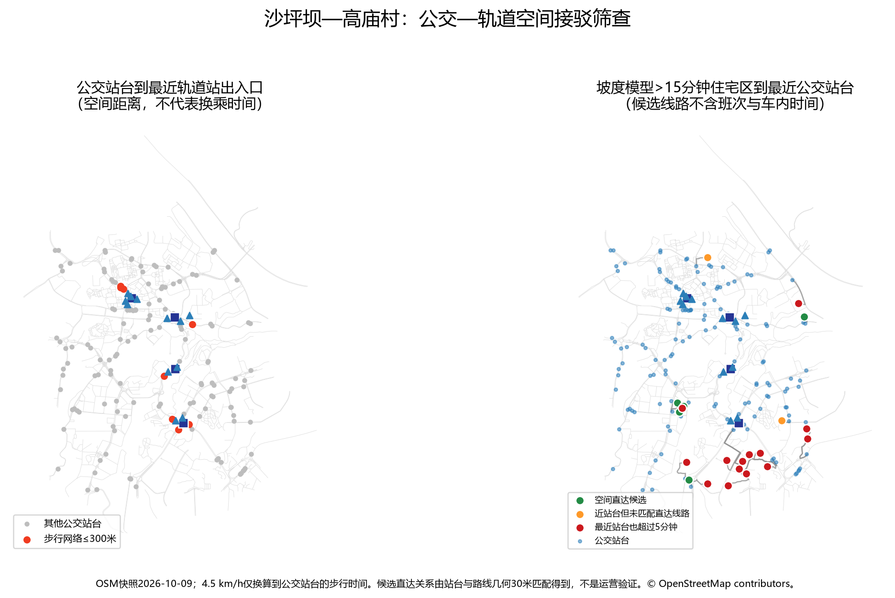

# 沙坪坝—高庙村公交—轨道空间接驳筛查

分析日期：2026-10-17（Asia/Shanghai） 
结论性质：OSM站台、路线关系和步行道路的空间筛查；不含班次、等待、车内时间、可靠性或客流

## 1. 本轮回答了什么

本轮回答的是一个有限但可复现的问题：在坡度模型估计到轨道站超过15分钟的21个具名住宅区中，附近是否有已映射公交乘车站台，以及现有OSM路线几何是否显示出通往研究区4个轨道站周边的候选直达关系。

结果不能回答“公交是否真正便捷”。附近有站台只说明空间入口存在；只有线路确实停靠、方向正确、班次可接受、换乘步行合理且运营可靠时，公交才可能弥补轨道步行不便。本轮没有这些运营数据，因此不计算等待时间、车内时间或总接驳时间。

## 2. 主要结果

- 研究框内提取到144个OSM公交乘车站台，涉及74个不同站名。相反方向或同名不同站位按独立站台保留。
- 提取到55条方向性公交路线关系、28个不同线路编号；136个站台（94.4%）距至少一条公交路线关系几何不超过30米。
- 只有9个公交站台经步行道路网络距最近轨道出入口不超过300米；500米内有32个。300米是本研究筛查阈值，不是重庆官方服务标准。
- 坡度模型超过15分钟的21个住宅区中，14个住宅区到最近已映射公交站台也超过375米，即按4.5 km/h换算超过5分钟。
- 其余7个住宅区在375米内有站台：5个同时匹配到一条在轨道站300米范围出现的相同OSM线路编号，标记为“空间直达候选”；2个只有近站台，未匹配到候选直达线路。

这意味着：**在当前OSM快照和筛查规则下，公交站台的空间存在并没有覆盖大多数轨道步行超时住宅区；少数地点具备进一步核验直达接驳的条件，但尚不能证明公交服务有效。**

阈值敏感性显示：把住宅区到公交站台门槛从300米、375米放宽到500米，空间直达候选由4个、5个增至7个，到公交站台仍超门槛的住宅区由16个、14个降至11个。轨道端门槛在200—500米之间没有改变这组候选数量，因为相关线路编号已经出现在200米内站台。候选规模会随住宅端步行阈值改变，因此不应把“5个”视为精确服务人口或固定排名。

## 3. 轨道站周边公交站台

| 轨道站 | ≤200米站台 | ≤300米站台 | ≤500米站台 | 300米内站名数 | 300米内候选线路编号数 |
| --- | ---: | ---: | ---: | ---: | ---: |
| 沙坪坝 | 1 | 3 | 15 | 1 | 6 |
| 小龙坎 | 0 | 1 | 6 | 1 | 1 |
| 马家岩 | 2 | 2 | 3 | 1 | 5 |
| 高庙村 | 1 | 3 | 8 | 3 | 6 |

距离为公交站台到最近轨道出入口的最短步行网络距离，不是站点中心直线距离。沙坪坝站300米内的三个站台均名为“陈家湾”，说明站名数量与物理站台数量不能混用。

## 4. 值得继续核验的住宅区

### 4.1 空间直达候选

| 住宅区 | 坡度模型到轨道 | 最近公交站台 | 到站台步行 | OSM候选线路 | 候选接驳轨道站 |
| --- | ---: | --- | ---: | --- | --- |
| 凤天花园 | 24.1分 | 凤天大道 | 116米 / 1.5分 | 1429 | 高庙村 |
| 卓越·美丽山水 | 32.6分 | 羊角堡 | 184米 / 2.4分 | 210 | 小龙坎、沙坪坝 |
| 凯莱阳光 | 20.9分 | 美茵河谷 | 184米 / 2.5分 | 209 | 沙坪坝 |
| 升伟·新时空 | 24.4分 | 凤天大道北段 | 281米 / 3.7分 | 209 | 沙坪坝 |
| 周李小区 | 22.5分 | 凤天大道北段 | 350米 / 4.7分 | 209 | 沙坪坝 |

这些线路编号来自“住宅区最近站台附近30米内的路线几何”与“轨道站300米内站台附近30米内的路线几何”的交集。它不是OSM成员关系核验，更不是运营承诺。下一步必须核实线路是否仍运营、两个站台是否都实际停靠、行驶方向、班次和换乘入口。

### 4.2 近站台但没有匹配到直达线路

- 大城小爱：到“白马路”约200米（2.7分钟）。
- 电力小区：到“南开中学”约340米（4.5分钟）。

这两个地点说明“附近有公交站”不等于能接驳轨道。也可能是OSM路线关系缺失，因此应先核验站牌和线路，而不是直接判定公交不足。

### 4.3 最近已映射公交站台也较远

14个坡度模型超过15分钟的住宅区，到最近已映射公交站台超过375米。其中成都城投锦樾峰境约1,245米、玉灵小区约1,526米、保利中交·云上雅集和远洋城二期均超过1公里。这可能是真实的空间覆盖不足，也可能来自住宅代表点、OSM缺站台或道路拓扑缺失，适合作为下一轮现场和官方数据核验重点。

## 5. 数据与完整性

### 实际用于计算

- OpenStreetMap / Geofabrik重庆固定快照：2026-10-09；ODbL。
- 同一快照中的公交站台标签：`highway=bus_stop`、`bus=yes`、`public_transport=platform`。
- 同一快照中的公交路线关系：`route=bus`，路线编号来自`ref`。
- 既有4个已运营轨道站、12个出入口和7,456条步行道路边。
- 既有31个有效住宅区坡度基准结果。

### 没有用于计算

- 在线地图预计时间；
- 未确认复用条件的商业地图公交数据；
- 公交实时位置、班次、准点率、票价或客流；
- 不能稳定公开下载和复现的重庆公共数据平台目录条目。

重庆市官方网页证明当地持续推进微循环、小巷和响应式公交，并明确把衔接轨道作为目标，但公开新闻不能替代本研究区完整的站点—线路—班次表。参考：[沙滨路环线公交（2025-09-23）](https://jtysw.cq.gov.cn/sy_240/bmdt/202509/t20250923_15034216.html)、[沙坪坝微循环公交（2026-05-13）](https://jtysw.cq.gov.cn/sy_240/bmdt/202605/t20260513_15674963.html)。

## 6. 方法

1. 从固定PBF按研究框提取公交乘车站台和公交路线关系。
2. 将站台吸附到既有步行道路图，计算站台到所有轨道出入口的最短步行网络距离。
3. 用200、300、500米展示空间分布；不把阈值解释为实际换乘质量。
4. 将31个住宅区代表点吸附到同一道路图，计算到最近公交站台的距离。
5. 对坡度模型到轨道超过15分钟的住宅区，以375米作为5分钟固定步速筛查阈值。
6. 站台距路线关系几何不超过30米时，记录为候选线路编号。住宅区最近站台和轨道站300米内站台出现相同编号时，标记为空间直达候选。

## 7. 局限与可反驳检查

- OSM不是运营部门完整台账；缺失、停运或更新滞后都可能改变结果。
- 30米几何匹配可能把邻近但不停靠的线路误配给站台，也可能漏掉几何偏移较大的真实线路。
- 住宅区只使用一个代表点；实际大门可能更靠近或更远离公交站台。
- 到公交站台使用固定4.5 km/h，没有加入坡度和过街等待。
- 轨道站300米范围不代表换乘通道质量；站内步行没有计算。
- 没有时刻或频率数据，不能比较公交接驳与直接步行的总时间。
- 31个住宅区样本没有人口权重，不能估计受益人口。

可反驳本结果的最低成本方法是：现场核验5个候选住宅区的实际大门与站牌，拍摄线路牌；再从运营方获得这些线路的方向、停靠站序列和工作日班次。若任一候选线路不同时停靠住宅端和轨道端站台，应从候选中删除。

## 8. 可复现成果

- `src/chongqing_rail_transit/bus_feeder_accessibility.py`
- `data/processed/shapingba_bus_platform_rail_access.csv`
- `data/processed/shapingba_bus_rail_station_summary.csv`
- `data/processed/shapingba_residential_bus_feeder_screen.csv`
- `data/processed/shapingba_bus_feeder_threshold_sensitivity.csv`
- `data/processed/shapingba_bus_rail_feeder_screen.gpkg`
- `reports/figures/shapingba_bus_rail_feeder_screen.png`
