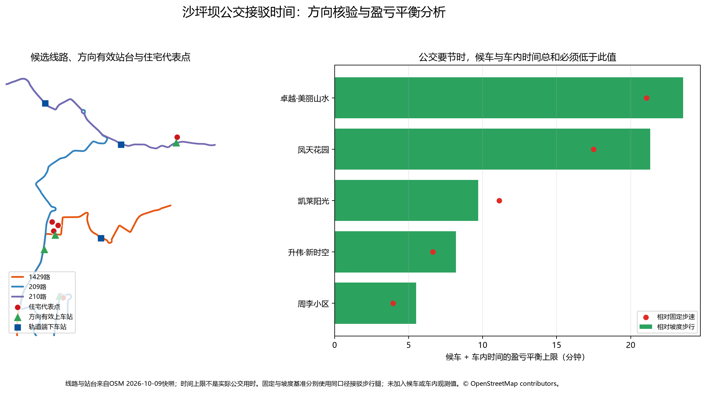

# 公交接驳能否比直接步行更快？——方向核验与盈亏平衡分析

查询日期：2026-10-17

空间数据：OpenStreetMap / Geofabrik 重庆固定快照（2026-10-09，ODbL）

## 结论先行

现有证据不足以给出任何一个住宅区的“实际公交总时间”，因为没有取得可复核的分时段发车间隔、候车观测和区间车内时间。研究因此没有填入假定的确定值，而是计算公交要优于直接步行时，**候车时间与车内时间总和必须低于多少**。

方向关系核验改变了此前5个空间候选中的3个：凤天花园和卓越·美丽山水的初筛站台确实属于所需方向；凯莱阳光需改用路线关系中的另一处同名“美茵河谷”站台；升伟·新时空和周李小区的“凤天大道北段”站台并不是209路关系成员，原候选属于路线几何近邻造成的假阳性，最近的方向有效替代站为西南医院。

| 住宅区 | 线路与方向 | 修正后的上车站 | 轨道端下车站 | 两段步行：固定/坡度（分钟） | 候车+车内上限：固定/坡度（分钟） | 判断 |
|---|---|---|---|---:|---:|---|
| 凤天花园 | 1429 万科→香榭街路口 | 凤天大道 | 高庙村西 | 2.55 / 2.73 | 17.48 / 21.33 | 方向与站序明确，适合首先实测 |
| 卓越·美丽山水 | 210 菜园坝→白公馆 | 羊角堡 | 小龙坎立交 | 6.09 / 9.04 | 21.06 / 23.53 | 时间余量大，但菜园坝端施工使现行运营需复核 |
| 凯莱阳光 | 209 兰美路→井口 | 美茵河谷（修正站台） | 陈家湾 | 8.59 / 11.21 | 11.11 / 9.69 | 有可能节时，但需13个站序跨度且余量有限 |
| 升伟·新时空 | 209 兰美路→井口 | 西南医院（替代站） | 陈家湾 | 13.19 / 16.21 | 6.63 / 8.20 | 原候选站台无效；仅在短候车、短车内时间下可能节时 |
| 周李小区 | 209 兰美路→井口 | 西南医院（替代站） | 陈家湾 | 14.12 / 17.00 | 3.93 / 5.50 | 原候选站台无效；固定步速基准下余量很小 |

“上限”不是预测公交用时。例如，凤天花园相对固定步速基准的17.48分钟表示：只有候车与车内时间合计低于17.48分钟，接驳总时间才可能短于直接步行。所有数值均为模型估计，不是实测。

## 方向与运营证据

- 209路：OSM方向关系 `21428493` 显示兰美路立交南→井口工业园，并给出美茵河谷、西南医院、陈家湾的先后顺序。第三方页面提供了运营时段及“约22分钟”间隔，但未找到运营方时刻表，因此这些班次数字没有进入计算。
- 210路：OSM方向关系 `21404246` 显示菜园坝火车站→白公馆，羊角堡在小龙坎立交之前。第三方页面列出运营时段；[重庆市政府2026-03-26提示](https://www.cq.gov.cn/ywdt/bmts/202603/t20260326_15569436.html)说明菜园坝枢纽施工期公交停靠有调整，因此终端现状存在额外不确定性。
- 1429路：OSM方向关系 `21469227` 显示万科金色悦城三期→香榭街路口，凤天大道在高庙村西之前。百度地图动态页面列有线路和首末班，但不是运营方时刻表。另发现一则网络问政回复带有明确的第三方转载/摘编限制，本研究只记录其许可审查结果，不复制或使用正文事实。

逐条来源、日期、可靠性与使用限制见 [`shapingba_bus_route_operation_evidence.csv`](../data/processed/shapingba_bus_route_operation_evidence.csv)。OSM能支持空间方向和站序检查，但不能证明车辆正在按图运营。

## 发车间隔敏感性

敏感性表采用“随机到站时平均候车时间 = 发车间隔的一半”的参数假设；它不是对实际乘客到站行为的观测。以固定步速直接步行为比较基准：

- 卓越·美丽山水在10分钟假设班距下，车内时间仍需低于16.06分钟；20分钟班距下需低于11.06分钟。
- 凤天花园在10分钟班距下，车内时间需低于12.48分钟；20分钟班距下需低于7.48分钟。
- 凯莱阳光在10分钟班距下，车内时间需低于6.11分钟；20分钟班距下仅剩1.11分钟，因而对班距非常敏感。
- 升伟·新时空在10分钟班距下只剩1.63分钟车内时间；班距达到15分钟时，即使车内时间为零也无法超过固定步速直接步行。
- 周李小区在10分钟班距下已经没有非负车内时间余量；它不再是优先公交接驳候选。

完整的5、10、15、20、30分钟参数结果见 [`shapingba_bus_feeder_wait_sensitivity.csv`](../data/processed/shapingba_bus_feeder_wait_sensitivity.csv)。

## 方法

1. 从此前坡度模型超过15分钟的住宅候选开始。
2. 不再用“站台距离线路几何30米”直接判断停靠，而是检查OSM具体方向关系中的站台成员及顺序。
3. 用同一OSM步行网络重新计算住宅代表点到方向有效上车站的最短距离。
4. 固定速度比较沿用下车站到最近轨道出入口的网络距离；坡度比较重新计算住宅→上车站及下车站→该轨道站全部入口的方向性最短时间。
5. 计算：`可用候车+车内时间 = 直接步行时间 - 上车步行 - 下车步行`。
6. 同时报告固定4.5 km/h和坡度模型两个基准；每个基准都扣除同口径的两端接驳步行，避免用坡度直接步行减去固定速度接驳步行的混合口径。

## 哪些结论仍不确定

- 没有运营方分高峰/平峰的发车间隔或可复核时刻表。
- 没有五个候选区间的实测车内时间、候车时间和可靠性分布。
- OSM关系的更新日期较新，但仍可能与临时绕行、施工调整或现场站牌不一致。
- 住宅代表点不代表每一栋楼入口；坡度接驳步行使用约30米SRTM，不能解析楼梯、室内通道、挡墙或立体道路真实高差。
- 固定步速与坡度模型给出的盈亏平衡上限差异较大，不能只选较宽松的坡度结果来证明公交有利。

## 下一步实地调查优先级

下表是**调查顺序**，不是线路服务质量或“公交已经更快”的排名。上车步行与盈亏平衡均同时列出固定速度/坡度模型值。

| 顺序 | 住宅区/线路 | 有效上车站→轨道端下车站 | 住宅→上车站（分钟） | 候车+车内上限（分钟） | 决定性未知数据 | 优先理由 |
|---:|---|---|---:|---:|---|---|
| 1 | 凤天花园 / 1429 | 凤天大道→高庙村西 | 1.55 / 1.76 | 17.48 / 21.33 | 分时段班距、实际候车、3站车内时间、运营时段 | 方向与站序清楚、上车步行短，可最快检验是否可能节时 |
| 2 | 卓越·美丽山水 / 210 | 羊角堡→小龙坎立交 | 2.45 / 2.83 | 21.06 / 23.53 | 施工期线路状态、实际停靠、班距、2站车内时间 | 理论余量大，但须先解决210路现状不确定性 |
| 3 | 凯莱阳光 / 209 | 美茵河谷→陈家湾 | 3.73 / 4.19 | 11.11 / 9.69 | 班距、13站车内时间、同名站台位置、换乘端步行 | 方向站台已纠正，但较长站序可能耗尽余量 |
| 4 | 升伟·新时空 / 209 | 西南医院→陈家湾 | 8.33 / 9.19 | 6.63 / 8.20 | 到西南医院的现场步行、班距、6站车内时间 | 原上车站匹配为误报，替代站步行已较长 |
| 5 | 周李小区 / 209 | 西南医院→陈家湾 | 9.26 / 9.97 | 3.93 / 5.50 | 到西南医院的现场步行、班距、6站车内时间 | 盈亏平衡余量最小，先验上最难节时但仍需数据反证 |

可机读版本见 [`shapingba_bus_feeder_survey_priority.csv`](../data/processed/shapingba_bus_feeder_survey_priority.csv)。
