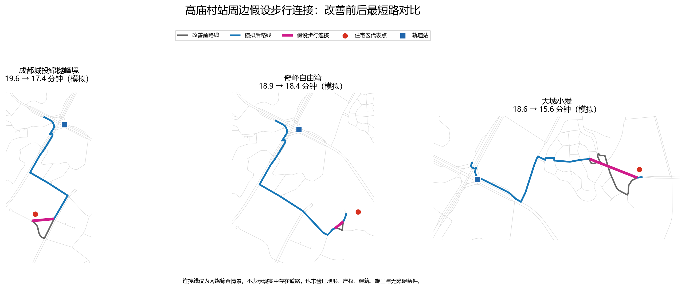

# 高庙村站周边假设步行连接案例研究

分析日期：2026-10-14（Asia/Shanghai） 
数据：OpenStreetMap / Geofabrik 重庆固定快照，2026-10-09 
结论性质：网络模型情景，不是实测结果、工程设计或建设建议

## 1. 本轮实际回答的问题

上一阶段用“直线距离×1.25”筛查了可能受道路绕行影响的住宅区。本轮进一步增加空间约束：只允许在住宅区当前最短路上的两个既有道路节点之间增加一条直线连接，连接长度20—250米，且被替代路段至少为连接长度的1.5倍。

这比上一阶段的直接性上界更接近一个明确的网络改造情景，但连接线仍没有经过地形、建筑、产权和施工核验。

## 2. 案例选择

选择上一阶段绕行改善潜力最大的3个住宅区，最近模型站均为高庙村：

| 住宅区 | OSM代表点位置（WGS84） | 当前模型时间 | 当前网络距离 | 相对出入口直线绕行比 | 数据可信程度 |
| --- | --- | ---: | ---: | ---: | --- |
| 成都城投锦樾峰境 | 106.463431, 29.532794 | 19.6分钟 | 1,473米 | 2.07 | 现状网络效果中等；新连接可建性低 |
| 奇峰自由湾 | 106.469639, 29.533911 | 18.9分钟 | 1,415米 | 1.88 | 现状网络效果中等；新连接可建性低 |
| 大城小爱 | 106.473734, 29.539105 | 18.6分钟 | 1,397米 | 1.75 | 现状网络效果中等；新连接可建性低 |

“中等”表示数据可用于复现OSM网络上的相对变化，但住宅代表点不一定是现实大门，路线没有坡度和站内时间。“低”表示直线连接没有现场证据。

## 3. 模拟情景

对每个案例，只增加一条假设步行连接：

- 成都城投锦樾峰境：166.7米，替代现有332.6米绕行路段；
- 奇峰自由湾：71.5米，替代现有108.7米绕行路段；
- 大城小爱：244.9米，替代现有473.2米绕行路段。

没有模拟公交具体时间，因为缺少经核验的公交线路、站点、班次、候车和换乘数据。没有模拟新轨道出入口，因为没有站内结构、产权、消防和工程资料。

## 4. 改善效果

基准步速4.5 km/h：

| 住宅区 | 改善前距离 | 模拟后距离 | 距离减少 | 改善前时间 | 模拟后时间 | 节省时间 | 降幅 |
| --- | ---: | ---: | ---: | ---: | ---: | ---: | ---: |
| 成都城投锦樾峰境 | 1,473米 | 1,307米 | 166米 | 19.6分钟 | 17.4分钟 | 2.2分钟 | 11.3% |
| 奇峰自由湾 | 1,415米 | 1,377米 | 37米 | 18.9分钟 | 18.4分钟 | 0.5分钟 | 2.6% |
| 大城小爱 | 1,397米 | 1,169米 | 228米 | 18.6分钟 | 15.6分钟 | 3.0分钟 | 16.3% |

三处在基准步速下仍未进入15分钟范围。上一阶段“直线距离×1.25”得到的11.5—13.3分钟是理想化上界，不能作为单一短连接的预期效果。

### 高庙村站可达道路变化

| 案例 | 10分钟变化 | 15分钟变化 | 20分钟变化 |
| --- | ---: | ---: | ---: |
| 成都城投锦樾峰境 | 0.000 km | +0.061 km | +0.290 km |
| 奇峰自由湾 | 0.000 km | 0.000 km | +0.072 km |
| 大城小爱 | 0.000 km | +0.329 km | +1.216 km |

大城小爱情景的网络效果最大；奇峰自由湾的单一连接效果很小。可达道路增量不是人口或客流收益。

## 5. 敏感性

同时测试3.6、4.5、5.4 km/h步速，以及假设连接等效成本为几何长度的1.00、1.25和1.50倍。

- 3.6 km/h：全部27个案例组合中的3个住宅区都仍超过15分钟；
- 4.5 km/h：3处在所有连接成本下均仍超过15分钟；
- 5.4 km/h：大城小爱三个连接成本情景均进入15分钟；成都城投锦樾峰境仅在1.00和1.25倍成本下进入15分钟；奇峰自由湾始终未进入15分钟。

因此，单一短连接能否跨过15分钟阈值对步速和连接阻抗敏感。距离和百分比改善比“是否跨线”更稳定。

## 6. 实际价值判断

### 大城小爱

- 解决的问题：当前路线存在约473米局部绕行；
- 模型效果：减少228米、3.0分钟，15分钟可达道路增加0.329公里；
- 潜在受益者：该住宅区及可能使用同一连接的周边步行者，人数未知；
- 限制：假设连接长244.9米，已经接近筛查上限，可能涉及较大的高差、用地或建设成本；
- 判断：值得优先实地核验，但证据不足以推荐建设。

### 成都城投锦樾峰境

- 解决的问题：约333米道路绕行可由166.7米连接替代；
- 模型效果：减少166米、2.2分钟，15分钟可达道路增加0.061公里；
- 限制：基准情景仍需17.4分钟，不能单独解决15分钟可达问题；
- 判断：可作为次优现场核验对象，需同时检查小区真实开口和其他连续改善。

### 奇峰自由湾

- 解决的问题：局部绕行较短；
- 模型效果：只减少37米、0.5分钟；
- 限制：即使采用低成本连接，基准模型仍为18.4分钟；
- 判断：现有证据不支持优先推进单一连接，除非现场发现OSM漏路或实际出入口明显不同。

## 7. 不能由本轮支持的结论

- 不能声称连接线现实存在、可合法通行或具备工程可行性；
- 不能估计建设成本、经济收益率、客流或受益人口；
- 不能证明坡度、封闭小区、道路跨越或产权是具体原因；
- 不能比较公交接驳时间，也不能推荐新增轨道出入口。

下一步应先现场或通过可靠影像/规划资料核验大城小爱和成都城投锦樾峰境的连接端点，并获取高程数据。若连接不可行，再转向有真实站点、线路和班次数据的公交接驳模拟。
