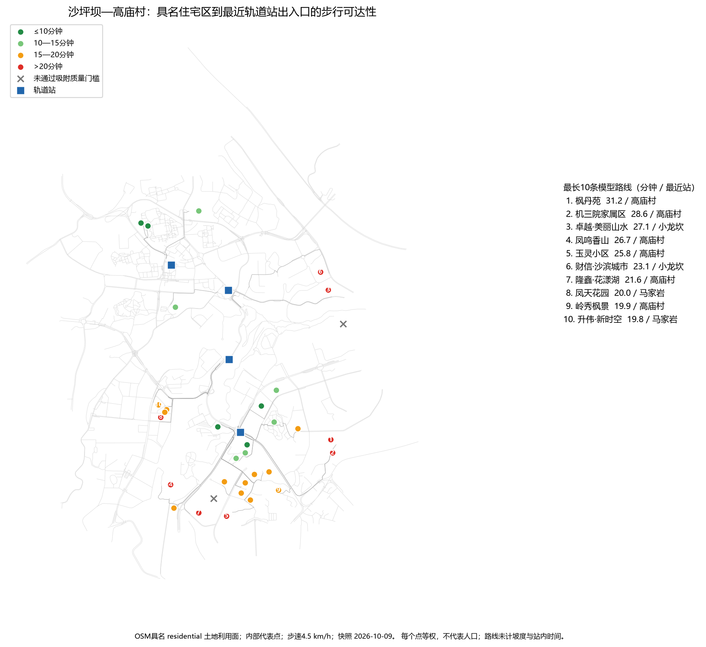

# 沙坪坝—高庙村具名住宅区步行可达性筛查

分析日期：2026-10-14（Asia/Shanghai） 
数据快照：OpenStreetMap / Geofabrik 重庆，2026-10-09 
研究性质：小范围、可复现的候选问题筛查，不是人口覆盖或工程可行性研究

## 1. 本轮回答的问题

本轮把已有“从车站出发能走到哪里”的模型扩展为“具体具名住宅区到最近轨道站出入口要走多久”。研究对象是沙坪坝、小龙坎、马家岩和高庙村4站周边、OSM 中有名称的 `landuse=residential` 面。

每个住宅区用面内代表点作为模拟起点，每个点等权。该做法可以定位候选问题区域，但不能回答有多少居民受影响，也不能比较不同住宅区的重要性。

## 2. 数据与质量门槛

- 道路、车站出入口和具名住宅区均来自同一 OSM 固定快照；
- 住宅区只保留有名称的 `landuse=residential` 面，共33个；
- 代表点吸附到最近步行网络节点，最大允许距离150米；
- 31个住宅区通过门槛，2个被排除：揽江雅苑（158.0米）和美茵河谷（169.4米）；
- 车站仍使用12个已映射出入口，并以最近出入口而不是站中心作为终点。

排除不表示两个住宅区真实不可步行，只表示现有 OSM 道路表达不足以支持可靠计算。

## 3. 主要结果

按固定步速4.5 km/h：

- 超过10、15、20分钟的住宅区分别为26、20和8个；对应等权样本占比为83.9%、64.5%和25.8%；
- 31个有效具名住宅区中，20个模型步行时间超过15分钟，占等权样本的64.5%；
- 超过15分钟的20个样本中，14个在“直线距离 × 1.25”的理想化连接条件下仍超过1,125米，更像公交接驳或更大范围交通改善候选；
- 另有6个在直线距离上并不远，但现有网络绕行后超过15分钟，是优先核验步行连接、出入口、小区开口或跨越设施的候选；
- 超时样本的中位模型时间为19.8分钟，中位直线距离为994.9米，中位绕行比为1.64；未超时样本对应为10.1分钟、477.9米和1.43；
- 20个超时样本中14个的最近模型站为高庙村，4个为马家岩，2个为小龙坎；这只是本样本的空间分布，不是各站服务绩效排名。

最长的10条模型路线如下：

| 住宅区 | 最近站 | 模型时间（分钟） | 网络距离（米） | 直线距离（米） | 绕行比 |
| --- | --- | ---: | ---: | ---: | ---: |
| 枫丹苑 | 高庙村 | 31.2 | 2,339 | 1,257 | 1.86 |
| 机三院家属区 | 高庙村 | 28.6 | 2,144 | 1,320 | 1.62 |
| 卓越·美丽山水 | 小龙坎 | 27.1 | 2,036 | 1,073 | 1.90 |
| 凤鸣香山 | 高庙村 | 26.7 | 2,002 | 1,090 | 1.84 |
| 玉灵小区 | 高庙村 | 25.8 | 1,936 | 1,170 | 1.66 |
| 财信·沙滨城市 | 小龙坎 | 23.1 | 1,735 | 994 | 1.75 |
| 隆鑫·花漾湖 | 高庙村 | 21.6 | 1,622 | 1,202 | 1.35 |
| 凤天花园 | 马家岩 | 20.0 | 1,502 | 1,075 | 1.40 |
| 岭秀枫景 | 高庙村 | 19.9 | 1,492 | 1,030 | 1.45 |
| 升伟·新时空 | 马家岩 | 19.8 | 1,487 | 996 | 1.49 |

## 4. 因素拆分

### 4.1 距离本身

以“可实现路线长度为直线距离的1.25倍”作为透明的筛查假设，有14个超时住宅区仍无法进入15分钟阈值。这一组的主要限制是与4个既有车站出入口之间的空间距离，而不是单纯的道路绕行。对它们，仅修一条很短的步行连接未必足够，值得进一步检查公交接驳、站点接驳路径或更广泛的网络方案。

### 4.2 网络绕行

6个住宅区在1.25倍直线距离情景下可降到15分钟以内，属于步行连接筛查候选：成都城投锦樾峰境、奇峰自由湾、大城小爱、远洋城二期、保利中交·云上雅集、远洋城一期。它们都被模型分配到高庙村站，当前模型时间为16.6—19.6分钟，绕行比为1.43—2.07。

这6处应优先核验：小区是否存在未映射出入口、封闭边界能否合法穿行、道路或高差是否需要楼梯/坡道、能否连接到更近的连续人行网络。模型没有证明任何具体新通道可建设。

### 4.3 山地与楼梯

当前 OSM 最短路线中，20个超时样本没有使用被标为 `highway=steps` 的边。因此本轮不能据此得出“楼梯是主要原因”。更可能的解释包括 OSM 楼梯缺失、路线选择未经过楼梯或地形影响尚未进入权重。没有高程数据，本轮也不能量化坡度惩罚。

## 5. 改善情景与敏感性

基准速度下的阈值分布：

| 模型时间 | 住宅区数量 | 等权样本占比 |
| --- | ---: | ---: |
| ≤10分钟 | 5 | 16.1% |
| 10—15分钟 | 6 | 19.4% |
| 15—20分钟 | 12 | 38.7% |
| >20分钟 | 8 | 25.8% |

步速敏感性：

| 假设步速 | 超过15分钟 | 等权样本占比 |
| ---: | ---: | ---: |
| 3.6 km/h | 22 / 31 | 71.0% |
| 4.5 km/h | 20 / 31 | 64.5% |
| 5.4 km/h | 17 / 31 | 54.8% |

结论对步速敏感，但“存在一组明显超时住宅区”在三个速度情景下都成立。

对20个基准超时样本，理想化道路直接性上界为：

| 假设可实现路线长度 | 可降至15分钟以内 | 仍超过15分钟 |
| --- | ---: | ---: |
| 直线距离 × 1.15 | 7 | 13 |
| 直线距离 × 1.25 | 6 | 14 |
| 直线距离 × 1.40 | 5 | 15 |

该情景只回答“若存在足够直接且合法的连接，理论上有多少样本可能跨过15分钟阈值”。它没有计入高差、征地、产权、施工、治安、无障碍、维护或真实出入口位置，不能作为投资收益预测。

下一轮可直接使用 `shapingba_improvement_candidates.csv`：对6个 `walking_connection_screen` 候选建立具体新增连接边；对14个 `feeder_transit_screen` 候选加入公交站、线路、班次和换乘惩罚。表中的1.25倍情景时间和潜在时间缩减只是统一筛查基线，不是预计建成效果。

## 6. 验证

- 自动化测试：5项通过，包括距离换算、OSM访问过滤、图最短路、阈值边界裁剪和住宅路线/步速敏感性；
- 真实数据结构：4站、12出入口、7,456条图边、33个住宅区原点、31条有效路线；
- 31条路线的网络距离均不短于相应直线距离；
- 所有新增 GeoPackage 几何均有效且非空；
- 31个有效起点吸附距离最大128.0米，未超过150米门槛；
- 20个超时样本在1.25倍直接性规则下被完整分为6个连接候选和14个接驳候选。

道路图共有13个连通分量，最大分量含6,506个节点，占全部节点94.1%。12个车站出入口全部位于同一分量；31个通过吸附门槛的住宅起点全部能到达车站分量，没有住宅区因道路分量断开而被误判。2个排除记录均由起点距已映射道路超过150米造成。

原MVP会丢弃跨越10/15分钟阈值的整条道路边。本轮改为按端点最短路距离裁剪边界部分。修复后，4站10分钟可达道路分别增加0.14—1.54 km，15分钟增加0.60—2.36 km；这会更新服务区长度和地图，但不改变住宅区到站最短路时间。

## 7. 证据边界与下一步

本轮没有人口、建筑户数、高程、坡度、闸机/站内时间、道路实测速度或公交时刻表。OSM住宅面是否完整、名称和边界是否最新也未独立核验。代表点不一定是住宅区真实大门。

下一轮优先级应是：对6个步行连接候选逐一核验真实小区出入口和跨越条件，并引入公开DEM计算坡度；随后再对14个接驳候选进行现有公交站点、线路和班次的可达性比较。只有取得人口或建筑容量数据后，才能把“住宅区数量”升级为“受影响居民规模”。
